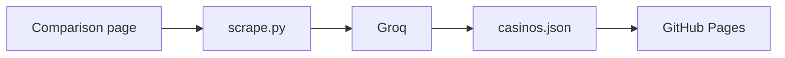

# Casino bonus scraper

Welcome-bonus terms for Mr Vegas, Casumo, and Videoslots, taken from one public page: [gambling.com/uk/online-casinos/bonus](https://www.gambling.com/uk/online-casinos/bonus). `scrape.py` checks robots.txt, cuts out each casino card, and asks Groq to return `welcome_bonus`, `wagering_multiplier`, and `min_deposit`. Results go to `data/casinos.json` and `docs/casinos.json`.

Live page: [maejor101.github.io/casino-offer-tracker](https://maejor101.github.io/casino-offer-tracker/)



## Run

```powershell
python -m venv .venv
.\.venv\Scripts\Activate.ps1
pip install -r requirements.txt
$env:LLM_API_KEY="your-groq-key"
$env:LLM_MODEL="openai/gpt-oss-120b"
python scrape.py
```

Get a key at [console.groq.com](https://console.groq.com). Do not commit it. Preview the page with `cd docs` then `python -m http.server 8000 --bind 127.0.0.1`, and open http://127.0.0.1:8000.

## Behaviour

robots.txt was allowed for this URL on 2026-10-13. The script checks it again every run, fetches that one page only, and stops on a block or a CAPTCHA. It does not fetch `/go/` redirects.

Each card is the `<li class="operator-item">` around the logo. `data-offer` is prepended as `Headline offer: …` so the model uses that headline. Wagering that is not in the card text is flagged `needs_review`. If any casino fails, the old JSON is left unchanged.

## Refresh

GitHub Pages deploys branch `main`, folder `/docs`. `.github/workflows/daily.yml` runs the scrape daily. It needs repository secret `LLM_API_KEY`, plus variables `LLM_MODEL=openai/gpt-oss-120b` and `LLM_BASE_URL=https://api.groq.com/openai/v1`. A blank base URL overrides the Groq default and the job fails.

A layout change on the source page, or a casino outside `TARGETS`, makes that run fail instead of guessing.
