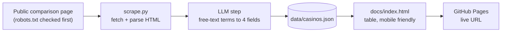

# Casino bonus scraper

Pulls welcome-bonus data for 3 UK casinos (Mr Vegas, Casumo, Videoslots) from one public
comparison page (`gambling.com/uk/online-casinos/bonus`), uses an LLM to turn the free-text
offer and T&Cs into structured fields, writes `data/casinos.json`, and shows it on a static
page (`docs/index.html`).

Fields per casino: `welcome_bonus`, `wagering_multiplier`, `min_deposit`, `source_url`.

## Architecture



## Install and run

```bash
python -m venv .venv && source .venv/bin/activate     # Windows: .venv\Scripts\Activate.ps1
pip install -r requirements.txt
export LLM_API_KEY=your-groq-key                      # free key: console.groq.com
export LLM_MODEL=openai/gpt-oss-120b
python scrape.py                                      # the single command
```

Windows PowerShell: use `$env:LLM_API_KEY="your-groq-key"` and `$env:LLM_MODEL="openai/gpt-oss-120b"` instead of `export`.

The default endpoint is Groq. Any OpenAI-compatible API works by also setting `LLM_BASE_URL`.
Never commit your key.

Output: `data/casinos.json` (also copied to `docs/casinos.json` for the page).
Preview locally: `cd docs && python -m http.server`, then open http://localhost:8000.

Before running, set your own repo URL in the `USER_AGENT` line of `scrape.py`.

## robots.txt and blocking

robots.txt checked on 2026-10-13: `/uk/online-casinos/bonus` is allowed for `User-agent: *`.
`/go/` (casino affiliate redirects) is disallowed and is never fetched. The script only
requests the single bonus page, once per run.

The script re-checks robots.txt on every run and exits if the URL is disallowed, or if the
site answers 401/403/429/503 or serves a CAPTCHA/challenge page. It never bypasses blocks.

## How it behaves

- Each casino card is the `<li class="operator-item">` around the logo. That element also carries `data-offer` with the exact headline. The scraper prepends it as `Headline offer: …` so the model uses that attribute as a hint instead of picking the offer out of the rest of the card text.
- The LLM runs at temperature 0 in JSON mode and is told to return `null` rather than guess; output is validated.
- Sanity check: if the extracted wagering number does not appear in the source text, the row is
  flagged `needs_review` and the page shows "unverified".
- If any casino fails, the run exits non-zero and leaves the previous JSON untouched.

## Deploy

GitHub Pages: Settings, Pages, deploy from branch `main`, folder `/docs`.
Optional daily refresh: `.github/workflows/daily.yml` (add repo secret `LLM_API_KEY`, repo
variable `LLM_MODEL=openai/gpt-oss-120b`, optionally `LLM_BASE_URL`).

## Known gaps

- Card extraction relies on the logo `title`/`alt` and the enclosing `<li>`; a layout change fails loudly.
- Only the three casinos in `TARGETS` are scraped.
